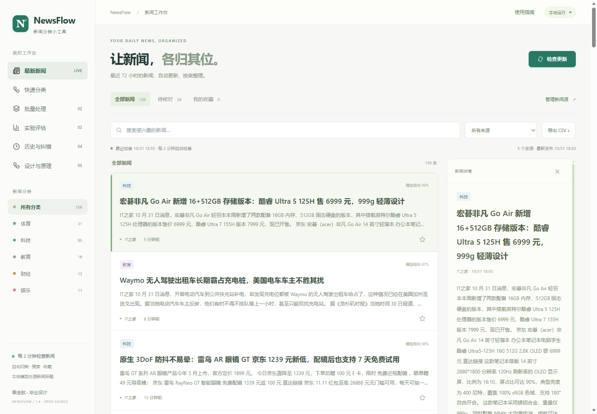

# NewsFlow · 新闻分类小工具

季金航 · 基于机器学习的中文新闻分类毕业设计 · 1.4

打开就能按体育、科技、教育、财经、娱乐浏览近期新闻。支持持续更新的 RSS/Atom、关键词搜索、来源筛选、收藏、分类依据和人工核对，适合在本机日常使用，也保留完整毕设实验。

[English](README_EN.md) · [使用与演示](docs/newsflow-guide.md) · [MIT 许可证](LICENSE)

> 部署状态：源码已公开，公网发布尚待仓库所有者补充 GitHub CLI 的 workflow 授权。下方网址当前尚未上线；下载版可使用。

**在线使用：[NewsFlow 公网新闻站](https://ma-jamess.github.io/newsflow/)**。公网版可以在其他设备访问，不需要运行本机 Python 服务。新闻由 GitHub Actions 约每 5 分钟抓取并用本地模型分类，调度可能延迟；收藏、纠错和来源显示偏好分别保存在每个浏览器。完整毕设程序仍可按下方步骤下载运行。

公网部署、缓存行为和更新规则见 [公网版说明](docs/public-site-guide.md)。



完整源码、训练数据、模型与实验报告随包提供；其他人可以解压并安装自己的实例。日常新闻功能使用本地模型，无需购买新闻 API 或配置大模型密钥。

## 直接启动

在本目录打开 PowerShell：

```powershell
python run.py
```

或双击 `run.bat`。默认打开 Microsoft Edge，地址为 `http://127.0.0.1:8510`，与原版端口不同，可同时运行对照。

首次运行会在本项目创建 `.venv` 并安装依赖，安装需要联网。发行包已附带公开数据与训练模型；版本和源码一致时直接加载，若环境不同或模型过期则自动重新训练。开发机完整实验约49秒，其他机器耗时不同。新闻订阅需要联网，已缓存新闻保存在本机。退出运行窗口按 Ctrl+C。

Python 3.11–3.13，推荐3.13。支持 Windows 10/11。缺少 Python 时先安装 Python 并确保命令 `python --version` 可用。

```powershell
python run.py --port 8511        # 默认端口占用时更换
python run.py --no-browser       # 只运行服务，不打开浏览器
python run.py --setup-only       # 准备环境、数据、模型后退出
python run.py --retrain          # 用同一份公开数据重新训练
python run.py --no-install       # 使用就绪环境，缺少依赖直接提示
```

启动脚本使用自身所在目录，不依赖终端当前工作目录。不会读取或写入参考版本路径。

## 使用方法

**最新新闻**是默认首页：分类、来源、搜索、收藏和待核对筛选取交集，点击标题查看文本摘要和分类依据，打开原文或人工修改类别。默认显示近 72 小时新闻，收藏可保留更早条目；当前筛选结果可导出 CSV，最多 5000 条。

默认接入 IT之家、少数派、中新网体育、财经和教育 RSS，另有可开启的中新网即时订阅。新闻源管理支持启停与添加公开 HTTPS RSS/Atom，显示最近读取、最新发布时间与连接状态。默认来源已在 2026-10-31 实测。

服务每 **120 秒检查更新**，页面每 20 秒读取缓存，手动检查冷却 30 秒。新闻到达时间仍取决于来源发布；“最近检查”与“新闻发布时间”分别显示。旧订阅不会因为返回成功就显示成新新闻。来源失败时保留缓存，其余来源继续更新；刷新保留收藏和人工类别。

自动新闻只调用本地推荐模型及阈值 0.65。来源频道不是分类答案，当前新闻的分类仍可能有误。

可选 **DeepSeek V4.1 Flash 1017**，官方调用名为 `deepseek-flash`。本机密钥配置完成后，快速分类页默认选择 DeepSeek；下拉框可切回本地算法。DeepSeek 使用思考模式，返回类别和理由；五类外或信息不足时允许不分类，不显示未经校准的概率。理由可在历史中查看并随 CSV 导出。测试准确率仅属于本地算法，未作为 DeepSeek 或实时新闻效果指标。

DeepSeek 只在用户手动提交快速分类时把本条标题发送至官方 API 并按量计费；自动新闻与批量处理使用本地算法。“带到快速分类”只填入标题，不自动提交。密钥读取环境变量 `DEEPSEEK_API_KEY` 或本机 `runtime/deepseek.env`（环境变量优先），不会写入前端、历史或完整源码包。发行包使用者需配置自己的密钥。详见 [DeepSeek 接入说明](docs/deepseek-integration.md)。

批量类别分布、组合筛选、待核对导出、批量独立阈值、历史核对队列与低概率排序、Ctrl+Enter 和结果复制均保留。早期界面参考见 [GitHub参考与改进](docs/GitHub参考与改进.md)。

首次使用和答辩演示可按 [使用演示与注意事项](docs/使用演示与注意事项.md) 操作，包含实测示例、CSV格式、阈值含义和常见问题。

1. **快速分类**：输入新闻标题或点示例，选择算法和核对阈值。显示类别、五类概率、实际文字特征贡献和分词。概率低或前两类相近时提示人工核对。可并列对照同一标题的三种算法；页面保留已提交标题，修改输入或阈值会提示结果需要更新。
2. **批量处理**：上传 `title` / `标题` 列的 CSV，或粘贴每行一个标题。先点“先预览输入”检查前10行、总行数和无效标题数，再分类。支持 UTF-8、GB18030；最大5 MB、5000行、每条200字。可用 `examples/batch-demo.csv` 演示。可选 `label` / `真实类别` 列，使用五类中文标签；本批有有效真实标签时显示本批指标。
3. **实验评估**：展示三种算法的选参集、测试集、校准前后结果，混淆矩阵、每类指标、错误样本、ECE 和 Brier。支持下载完整 JSON，以及所选算法全部误分类 CSV（不限于页面展示的30条）。
4. **历史与纠错**：单条分类自动保存；人工标注正确类别和备注。页面展示最近1000条，导出最近5000条。数据库在 `runtime/history.sqlite3`，超过导出上限的记录仍保存在数据库中。
5. **设计与原理**：说明数据边界、算法、解释方式和局限，便于答辩。

批量结果不会写入历史；人工纠错只留档，不自动改模型。本地算法在本机处理标题，选择 DeepSeek 时会调用官方 API。应用只监听127.0.0.1，不提供远程访问或账号管理。

## 固定历史测试集的实验结果

| 模型 | 参数 | 测试准确率 | 测试宏 F1 | ECE | Brier |
| --- | --- | --- | --- | --- | --- |
| 词特征朴素贝叶斯 | α=0.1 | 95.1493% | 0.951517 | 0.02654 | 0.07563 |
| 字词联合逻辑回归 | C=4 | 96.6927% | 0.966971 | 0.02068 | 0.05446 |
| 字词联合线性 SVM | C=1 | **96.9333%** | **0.969351** | **0.01167** | **0.04793** |

数据：训练89,887条，验证选参2,493条，独立校准2,493条，测试4,989条。推荐 SVM 完全由选参集决定，不依据测试指标选择。表中概率和预测已经校准。固定种子42。

原版最佳模型记录准确率96.0313%；两版4,989条测试标题与标签顺序完全一致。新版提升0.9020个百分点。两者特征和验证策略有区别，因此这是一组完整系统的同测试集比较，不能据此单独断言每一项改动的贡献，也不能代表最新新闻效果。详见 `docs/版本对比.md`。

## 源码结构

```text
run.py / run.bat         Python 一键启动与 Edge 打开
newsroom/data.py        归一化、去重、数据校验
newsroom/csvio.py       CSV 严格解析、安全导出
newsroom/ml.py          特征、训练、校准、评估与解释
newsroom/feeds.py       RSS/Atom 读取、日期解析与公网地址检查
newsroom/news_store.py  独立新闻缓存、来源、收藏与人工类别
newsroom/live_news.py   后台更新协调、本地分类与更新状态
newsroom/store.py       SQLite 历史和人工标注
newsroom/deepseek.py    用户手动提交的可选官方 API 接入
newsroom/server.py      本地 HTTP 接口和静态文件服务
web/                    HTML、CSS、JavaScript 全部前端源码
scripts/train.py        独立可复现实验
scripts/prepare_data.py 恢复固定版本公开数据
scripts/build_docs.py   从实际实验生成论文初稿与对比说明
scripts/compare_versions.py 严格对齐两版已有预测，生成逐条差异
scripts/make_figures.py 从本项目真实报告生成三幅论文配图
scripts/package.py      独立交付包与源码清单
tests/                  数据、模型、新闻源、API、并发与前端回归
data/raw/               公开数据、上游 README 和 LICENSE
artifacts/              自己训练的模型、报告、测试预测明细
docs/                   设计、计划、验证记录和两版比较
thesis/                 论文初稿、答辩讲稿、独立配图
examples/               演示 CSV
```

## 分步复现

```powershell
python -m venv .venv
.venv\Scripts\python -m pip install -r requirements-dev.txt
.venv\Scripts\python scripts/prepare_data.py
.venv\Scripts\python scripts/train.py
.venv\Scripts\python -m pytest -q
python run.py
```

前端回归检查使用 Node.js 18 或更新版本。PowerShell 运行全部检查：

```powershell
node --test (Get-ChildItem tests -Filter '*.test.cjs' | Select-Object -ExpandProperty FullName)
```

日常 `python run.py` 启动不需要 Node.js。

论文配图可运行 `.venv\Scripts\python scripts/make_figures.py` 重新生成；需要开发依赖中的 matplotlib。逐条比较脚本的 `--old` 参数接受另一份测试预测 CSV，并严格核对标题、标签与顺序；不调用参考版本代码、不重新训练模型。旧版本源码包保留供回溯。

数据清洗与选参源码可直接读，不需要原版项目。原始数据受上游仓库许可证与语料原有权利约束；保留 `data/raw/LICENSE` 和来源记录。

## 局限

只支持五类；高分不保证正确，不检测新闻真伪。训练语料年份较早，包含噪声标签。未评估当前新闻、五类外输入和长期分布变化。字符特征增加模型体积。当前论文为基于实测系统的技术初稿，提交前应根据学校模板核对个人信息、格式和参考文献要求。

## 分发与许可证

当前完整源码包为 `dist/NewsFlow_1.4_完整源码.zip`。运行 `.venv\Scripts\python scripts/package.py` 可重新生成，包内 `docs/source-inventory.json` 记录文件大小与 SHA-256。应用代码采用 MIT，可分发、修改和使用；第三方数据与图标许可证保留，新闻文字权利属于发布方。

源码包包含训练数据、模型、程序、实验报告与测试，排除 `.venv`、个人密钥、`runtime` 新闻/历史缓存和验证中间文件。每个使用者在自己机器上创建数据。

新闻页借鉴 [NewsNow](https://github.com/newsnext/newsnow) 的阅读组织与 [Horizon](https://github.com/Thysrael/Horizon) 的订阅工作流，延续 ThinkFlow 的工作台形式；没有复制这些项目代码。具体取舍和验证记录见 `docs/newsflow-guide.md` 与 `docs/newsflow-live-verification.json`。

最终代码复核与已知小问题见 [复核记录](docs/newsflow-code-review.md)。发行包的独立校验报告随 ZIP 单独提供。
